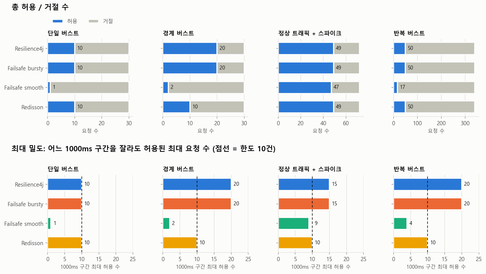
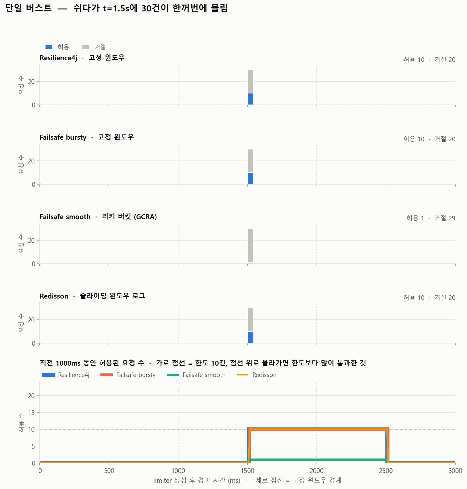
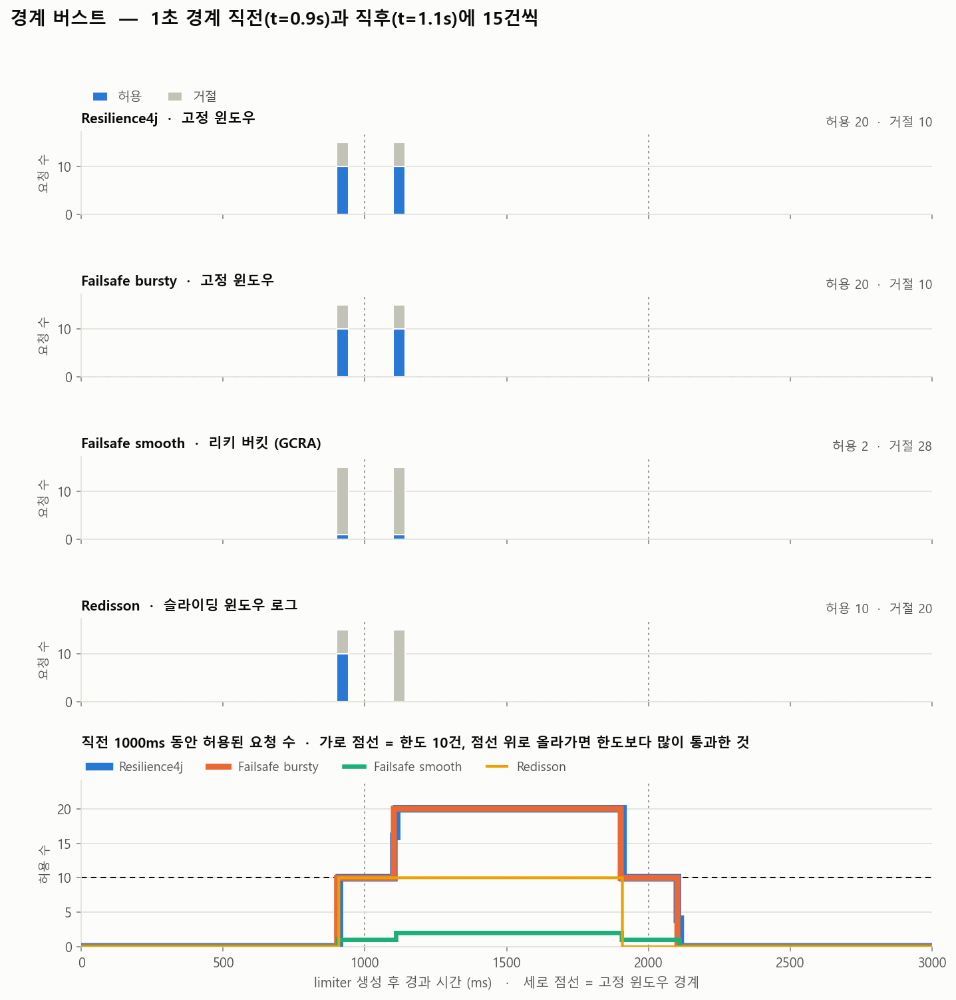
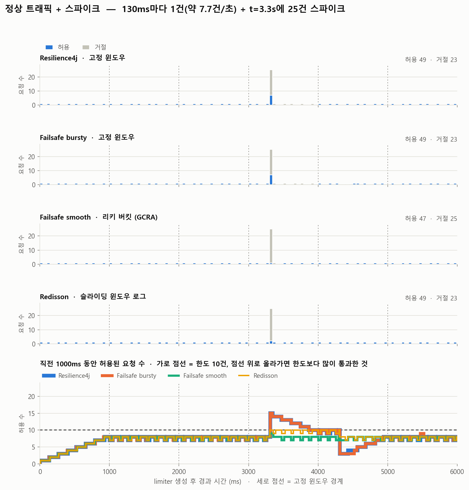
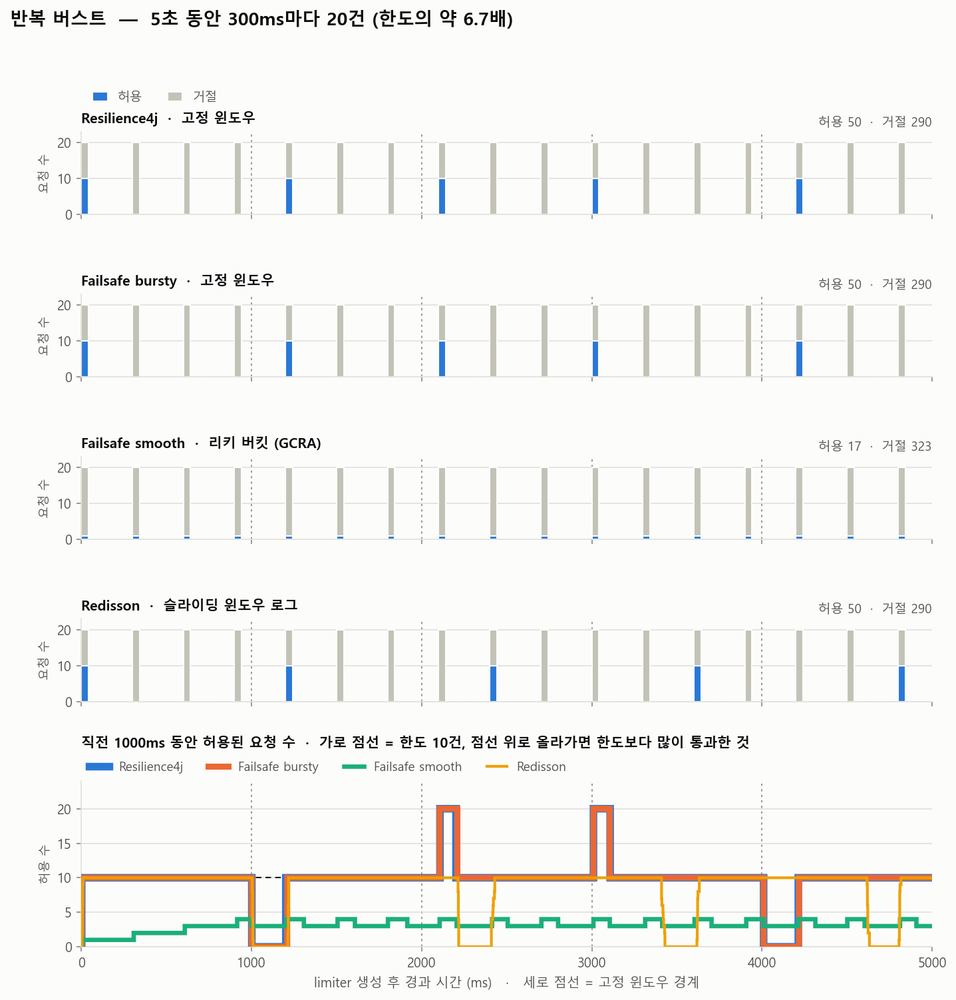

# Rate limiter 버스트 비교 실험

Resilience4j, Failsafe(bursty / smooth), Redisson의 rate limiter에 같은 트래픽을 흘려,
순간 버스트에서 허용·거절되는 요청 수가 어떻게 달라지는지 비교한다.
모든 limiter는 같은 설정(기본 **1초에 10건**)이고, 기다리지 않고 즉시 판정(`tryAcquire`)한다.

## 실행

```bash
docker compose up -d                 # Redis (Redisson용). 이미 떠 있으면 생략
./gradlew run                        # 결과: results/requests.csv, results/meta.csv
pip install pandas matplotlib numpy
python scripts/plot_results.py       # 결과: results/charts/*.png
```

옵션:

```bash
./gradlew run --args="--no-redis"                       # Redisson 제외
./gradlew run --args="--redis redis://host:6379"
./gradlew run --args="--permits 20 --period-ms 500"     # 한도 바꾸기
./gradlew run --args="--out results-2"
```

Gradle wrapper가 없으면 `gradle wrapper` 한 번 실행하거나, 설치된 `gradle run`을 쓰면 된다.

## 구조

```
src/main/java/experiment/
├── limiter/                         ← rate limiter 추상화
│   ├── RateLimiterAdapter.java          공통 인터페이스 (name, algorithm, tryAcquire, close)
│   ├── RateLimitSpec.java               공통 설정: period 동안 permits건
│   ├── LimiterFactory.java              실행마다 새 limiter 생성 (+ 비교 대상 목록)
│   ├── Resilience4jRateLimiterAdapter.java
│   ├── FailsafeRateLimiterAdapter.java  (SMOOTH / BURSTY)
│   └── RedissonRateLimiterAdapter.java
├── scenario/                        ← 트래픽 시뮬레이션
│   ├── TrafficScenario.java             "언제 몇 건을 동시에" 목록 + 빌더
│   └── Scenarios.java                   비교용 시나리오 4개
├── runner/                          ← 요청 발사 & 수집
│   ├── ScenarioRunner.java              wave 시각에 스레드들이 동시에 tryAcquire
│   ├── RequestRecord.java               요청 1건 = CSV 1줄
│   └── MetricsCollector.java            CSV 저장 + 콘솔 요약
└── ExperimentMain.java
scripts/plot_results.py              ← 시각화
```

새 limiter를 비교하려면 `RateLimiterAdapter`를 구현하고 `LimiterFactory.all()`에 한 줄 추가하면 된다.
(예: Bucket4j 토큰 버킷)

## 시나리오

| 이름 | 트래픽 | 보려는 것 |
|---|---|---|
| `single_burst` | 쉬다가 t=1.5s에 30건 | 순간 버스트를 몇 건까지 받아주나 |
| `boundary_burst` | t=0.9s에 15건, t=1.1s에 15건 | 윈도우 경계에서 한도의 2배가 통과하나 |
| `steady_with_spike` | 130ms마다 1건(≈7.7건/s) + t=3.3s에 25건 | 스파이크가 정상 요청을 밀어내나 |
| `repeated_bursts` | 300ms마다 20건, 5초간 | 지속 과부하에서의 처리량과 분포 |

t=0은 limiter 생성 시점이다. 고정 윈도우 경계는 t=1000, 2000, …ms에 생긴다.

## 결과 읽는 법

- **timeline_<시나리오>.png**
  - 위 4줄: limiter별 50ms 구간 허용(파랑) / 거절(회색) 수. 점선 세로줄은 고정 윈도우 경계.
  - 맨 아래: 각 시점에서 "직전 1초 동안 허용된 수". 가로 점선(한도)을 넘으면 그 구간에 한도보다 많이 통과한 것.
- **summary.png**: 시나리오별 총 허용/거절 수와, "어느 1초 구간을 잘라도 허용된 최대 건수".

## 예상(이론)과 실측

| 시나리오 | Resilience4j | Failsafe bursty | Failsafe smooth | Redisson |
|---|---|---|---|---|
| single_burst 허용 | 10 | 10 | 1 | 10 |
| boundary_burst 허용 / 1초 최대 | 20 / **20** | 20 / **20** | 2 / 2 | 10 / 10 |
| repeated_bursts 허용 / 1초 최대 | 50 / **20** | 50 / **20** | 17 / 4 | 50 / 10 |

- 고정 윈도우(Resilience4j, Failsafe bursty)는 경계 앞뒤로 몰리면 1초 안에 한도의 2배까지 통과한다.
- Redisson(슬라이딩 윈도우 로그)은 어느 1초 구간에서도 10건을 넘지 않는다. 대신 permit이 쓴 시점부터 정확히 1초 뒤에 돌아오므로, 다음 버스트를 받을 수 있는 시점이 고정 윈도우보다 늦어질 수 있다.
- Failsafe smooth는 100ms 슬롯마다 1건이라 버스트를 거의 받지 않는다. 트래픽이 몰려서 오면 평균 한도(10건/s)도 다 쓰지 못한다(`repeated_bursts`에서 17건).

## 주의

- 측정 시각은 JVM `System.nanoTime()` 기준이고, Redisson은 Redis Lua 안에서 `System.currentTimeMillis()`(ms 단위)를 쓴다. 요청이 정확히 1000ms 간격으로 겹치면 "1초 구간 최대" 지표가 ±1건 흔들릴 수 있어서, 시나리오 간격을 1000의 약수가 아니게 잡았다.
- Redisson은 네트워크 왕복이 있어 판정 지연이 로컬 limiter보다 길다. 버스트 안에서의 순서가 섞일 수 있지만 허용 개수에는 영향이 없다.
- 버스트는 스레드 64개로 동시에 쏜다. wave 하나가 64건을 넘으면 `ScenarioRunner` 생성 시 풀 크기를 늘려야 한다.

## 실행해봤을 때 나온 결과










